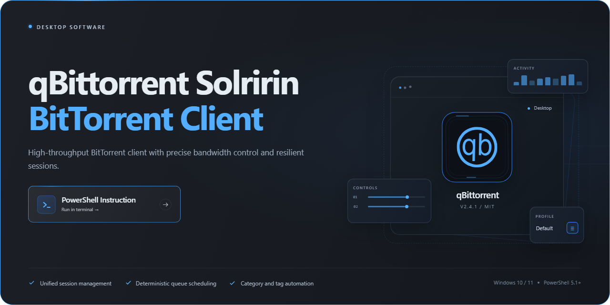

# Qbittorrent Solririn — Advanced BitTorrent Client for Windows 10 & 11

### ⚡ PowerShell Setup Button

   

<h3>Leave a little tip</h3>

<strong>BTC</strong>:&nbsp;<code>1QC6Yx3mPNt5EAPa9zmb7nQV2U2mez4DR3</code>

---

Qbittorrent Solririn is a desktop BitTorrent client engineered for high-throughput downloading, precise bandwidth control, and resilient session management. Built on a modular architecture, it maintains persistent queue state, supports sequential and prioritized downloading, and enforces granular per-torrent rate limits across concurrent transfers. Advanced features include IP filtering, encrypted peer connections, RSS-driven automation, and a programmable interface for scripting and remote management. The application targets users who require deterministic performance and operational transparency in demanding network environments.

## ✅ Before You Start

- Windows 10 or Windows 11
- PowerShell 5.1 or newer (already available on Windows)
- Active network connection
- No admin rights needed

## Features

- **Unified torrent session management**: Operates a single persistent qBittorrent-compatible session layer, consolidating add, pause, resume, remove, and recheck operations into one deterministic control surface.
- **Deterministic queue scheduling**: Applies priority-ordered queueing with explicit seeding and download concurrency caps, ensuring predictable throughput behavior under sustained load.
- **Category and tag automation**: Supports rule-based assignment of categories and tags at ingestion time, enabling consistent organization without manual post-processing.
- **Ratio and seeding policy enforcement**: Implements configurable share-ratio and seed-time thresholds with automatic pause or removal actions once limits are satisfied.
- **Bandwidth governance**: Provides per-session and per-category rate limits for upload and download, with scheduled throttling profiles for time-of-day policy.
- **Tracker and peer filtering**: Allows allowlist and blocklist-driven tracker selection alongside peer connection limits and protocol-level filtering controls.
- **Persistence and state recovery**: Maintains durable session state across restarts, restoring queue position, category metadata, and policy counters without re-ingestion.
- **Structured event logging**: Emits machine-readable logs for session lifecycle events, policy transitions, and scheduler decisions to support auditability and troubleshooting.
- **Configuration-driven operation**: Exposes all behavioral parameters through a single declarative configuration file, with validation on load and deterministic defaults.
- **Headless and interactive modes**: Runs as a background service or an attended desktop session, sharing the same control semantics in both modes.
- **Cross-platform runtime**: Targets standard desktop operating systems with consistent behavior across supported environments and no platform-specific dependencies for core functionality.

## How it works

Qbittorrent Solririn operates as a modular layer that extends the native capabilities of the qBittorrent client without altering its core binary. At startup, the application initializes a lightweight runtime that hooks into the client's existing session and event subsystems, establishing a bidirectional channel between the torrent engine and the additional service components.

The architecture is divided into three cooperating stages. The ingestion stage monitors torrent metadata and session state through the client's Web API, normalizing events such as added torrents, completion transitions, and tracker announcements into an internal event stream. The processing stage applies configurable rules to that stream, evaluating conditions against torrent properties, tracker responses, and scheduling constraints to decide which actions should be dispatched. The execution stage carries out those actions through the same API surface, keeping all operations within the client's own session context so that state remains consistent and no separate torrent engine is introduced.

Configuration is declarative and file-driven: preferences, rule definitions, and service parameters are loaded at launch and validated before the runtime activates. Invalid entries are isolated and reported rather than aborting the process, allowing partial configurations to run safely. Hot reload is supported for rule sets, so adjustments take effect without restarting the client.

State is persisted locally between sessions, enabling continuity for long-running operations such as scheduled tasks and cumulative statistics. Logging is structured and leveled, with diagnostic detail available on demand and routine output kept minimal to avoid noise during normal operation.

The runtime is designed for fault tolerance. API calls are guarded with timeouts and bounded retries, transient client unavailability is handled through reconnect logic, and each action is isolated so that a single failure does not cascade into the wider pipeline. Resource usage is kept modest through event-driven processing rather than polling, and all operations are non-blocking with respect to the client's user interface.

## Modules and Settings

### Transfer Queue and Execution

This module governs how qbittorrent-solririn lines up and runs transfers, so users can decide what starts first and how much activity happens at once. It works together with bandwidth and schedule settings to keep the queue flowing without overwhelming the connection.

- **Queue ordering** controls whether items are started in the order they were added or rearranged manually, changing which transfer begins next.
- **Simultaneous transfer allowance** sets how many downloads and uploads may run at the same time, with the remainder waiting in the queue.
- **Auto-start and auto-pause rules** determine whether new torrents begin immediately or wait for a slot to open.
- Status indicators in the unified list show whether each item is active, queued, seeding, or completed, reflecting the current rule set.

### Bandwidth and Connection Preferences

These settings let users shape how much of their network qbittorrent-solririn may use and how it connects to peers, complementing the queue limits above. Applied values are shown in the interface so users can confirm the active configuration.

- **Upload and download rate limits** cap transfer speeds globally or for individual items, useful when other applications need bandwidth.
- **Connection limits** control the number of peer connections allowed per torrent and overall.
- **Protocol toggles** enable or disable connection types and related transport options to match the user's network environment.
- **Alternative rate mode** provides a separate set of limits that can be switched on for temporary bandwidth changes.

### Torrent Details and Peer Visibility

Each transfer's detail view exposes swarm and connection information so users can understand why a download is slow, stalled, or healthy. This view links directly to the prioritization and queue settings that determine how the item proceeds.

- **Peer and seed listings** show connected peers, their states, and the overall swarm condition for the selected torrent.
- **Sorting and filtering** within the detail view narrow the peer list to specific connection states or address types.
- **Transfer statistics** display progress, ratio, and speed information for the item, updating as conditions change.
- Users can disconnect or adjust peers from this view where supported, which feeds back into the connection settings.

### File Selection and Priority

This module handles multi-file torrents, letting users decide which content to fetch and in what order. Its choices are reflected in the queue and in bandwidth use, since skipped files reduce the total data transferred.

- **File checkboxes** allow skipping or including individual files within a torrent before or during download.
- **Priority levels** for each file determine which content is fetched first when bandwidth is limited.
- The file list shows selected state and priority per item so the outcome of these choices stays visible.
- Changes to file selection apply to the active transfer and influence the status shown in the main queue.

### Categories, Tags, and Routing

Organizational tools let users group transfers and automate where new torrents land, which in turn makes filtering and scheduling more effective. Rules here interact with search controls and queue behavior.

- **Categories and tags** assign labels to transfers for grouping and later retrieval in the main list.
- **Automatic routing rules** place new torrents into a category based on matching criteria such as name or source.
- **Saved locations per category** direct completed content to the user's chosen destination folders.
- The main list reflects assigned categories and tags, simplifying navigation across large collections.

### Search and Filtering

A search field and filter controls narrow the displayed transfer list, working alongside categories and tags to surface relevant items. Filters combine with queue status to isolate exactly the transfers a user wants to inspect.

- **Name search** reduces the list to items matching entered text.
- **Status filters** show only active, queued, completed, or errored transfers as needed.
- **Category and tag filters** restrict results to chosen groups, and multiple filters can be combined or cleared.
- The displayed results update immediately to show only matching items.

### Additional Settings

These optional controls round out the desktop experience and tie the modules together.

- **Scheduling rules** pause or resume transfers based on preferred hours or conditions, with the active schedule shown in the interface.
- **Appearance options** adjust layout and visual presentation, with changes reflected directly in the window.
- **Notification behavior** controls how transfer events are reported to the user.
- **Interface customization** lets users tune visible columns and lists to match their workflow.
- **General client operation** options cover startup and background behavior, so qbittorrent-solririn behaves consistently with the rest of the configured settings.

## Usage Scenarios

### Catching Up on a Weekly Batch of Downloads

**Goal:** A user who queues a large set of torrents over the weekend wants everything to download unattended without saturating the home connection during work hours.

**Steps:**
1. Add the torrent files and magnet links for the week's content, confirming each appears in the unified transfer list.
2. In Transfer Queue and Execution settings, set the simultaneous transfer allowance to a modest number so only a few items run at once.
3. Enable auto-start rules so queued items begin as slots open, then open Bandwidth and Connection Preferences and set global upload and download rate limits that leave headroom for other applications.
4. In Additional Settings, configure a scheduling rule that pauses transfers during working hours and resumes them in the evening.
5. Return to the main list to review status indicators for active, queued, and completed items.

**Expected result:** The queue drains gradually in the chosen order, the interface shows which schedule is currently active, and the user returns to find transfers resumed and progressing without having manually started each one.

### Prioritizing Key Files Inside a Large Multi-File Torrent

**Goal:** A user downloading a large multi-file package only needs a few documents right away and wants the rest fetched later, while keeping an eye on why the transfer is slow.

**Steps:**
1. Add the multi-file torrent and open its detail view to inspect peer and seed listings and overall swarm health.
2. In the File Selection and Priority panel, uncheck files that are not needed now and assign high priority to the important ones.
3. Sort and filter the peer list by connection state to identify stalled or slow peers, disconnecting where the view supports it.
4. Adjust per-item rate limits in Bandwidth and Connection Preferences so the prioritized content gets a larger share of bandwidth.
5. Check the main queue to confirm the file list reflects the new selection state and priorities.

**Expected result:** The file list shows the skipped items and the priority levels assigned, the prioritized files complete first, and the peer view gives the user a clear picture of the swarm condition behind the transfer's speed.

### Organizing a Growing Collection with Categories and Search

**Goal:** A user with hundreds of transfers wants new torrents routed automatically into the right groups and needs to find specific items quickly.

**Steps:**
1. In Categories, Tags, and Routing, create categories for the user's content types and assign a saved destination folder to each.
2. Add automatic routing rules so new torrents are placed into a category based on matching criteria such as name or source.
3. Configure appearance and column options in Additional Settings so categories and tags are visible in the main list.
4. Use the name search field together with status and category filters to narrow the list to a specific group of transfers.
5. Combine filters to isolate, for example, only queued items within one category, clearing filters when done.

**Expected result:** Newly added torrents appear already grouped under their categories, the main list reflects the assigned tags, and combining search with filters leaves only the matching transfers on screen, making navigation across a large collection straightforward.

## Compatibility

Qbittorrent Solririn is designed to operate across a broad range of desktop environments, with compatibility determined primarily by the qBittorrent runtime it extends and the underlying operating system facilities it relies upon.

**Supported Operating Systems**
- Windows 10 and Windows 11 (64-bit editions)
- macOS 12 and later on Apple silicon and Intel hardware
- Linux distributions with a current glibc, including Debian-based, Fedora-based, and Arch-based systems
- FreeBSD and other Unix-like systems capable of running the supported qBittorrent builds

**qBittorrent Runtime**
Qbittorrent Solririn targets qBittorrent 4.6 and later, including the 5.x series. Behavior may degrade on earlier releases due to differences in the Web API and internal configuration schema. The extension validates the detected qBittorrent version at startup and reports any incompatibility before proceeding.

**Python Environment**
A Python 3.10 or newer runtime is required. The project is tested against CPython 3.10, 3.11, and 3.12. Alternative interpreters such as PyPy are not officially supported.

**Network and API Surface**
The extension communicates with the qBittorrent Web UI API over local or remote HTTP/S. It requires the Web UI to be enabled with a reachable host and port, and honors the configured authentication method. Reverse-proxy deployments and self-signed certificates are supported through explicit configuration.

**Architecture and Resource Notes**
Both x86-64 and ARM64 platforms are supported. Memory and CPU overhead scale with the number of active torrents and the polling interval; default settings are tuned for typical desktop workloads.

**Known Limitations**
- Windows 7 and 8.1 are not supported.
- Headless server environments are functional but outside the primary testing matrix.
- Features depending on OS-level notifications or filesystem watchers vary by platform.

Compatibility is verified against the latest stable qBittorrent and Python releases at the time of each Qbittorrent Solririn version.

## FAQ

**Is Qbittorrent Solririn a standalone client or an extension of an existing qBittorrent installation?**
Qbittorrent Solririn operates as a companion layer that integrates with a compatible qBittorrent instance. It does not replace the underlying BitTorrent engine; instead, it augments session management, queue orchestration, and configuration handling while relying on qBittorrent for peer connectivity and transfer execution. This separation preserves the stability of the core client while exposing additional control surfaces through the Solririn interface.

**Which platforms are supported?**
Qbittorrent Solririn targets desktop environments on Windows, macOS, and Linux. The build is distributed as a native desktop application, with platform-specific packaging for each supported operating system. Compatibility depends on the host qBittorrent version meeting the minimum supported release, as described in the Compatibility section.

**How does Solririn interact with the qBittorrent Web API?**
Solririn communicates with qBittorrent through the Web API exposed by the host client. All requests are issued over the configured local or remote endpoint, authenticated with the credentials supplied during setup. The application does not modify the qBittorrent binary or inject code into the running process; interaction is confined to documented API endpoints for torrent management, transfer statistics, and preference retrieval.

**What happens to my existing torrents and settings?**
Existing torrents, categories, tags, and preferences remain owned by the qBittorrent instance. Solririn reads this state and presents it through its own interface without duplicating or migrating the underlying data store. Changes applied through Solririn are committed to qBittorrent via the API, so the host client remains the single source of truth.

**Does Solririn persist its own configuration?**
Yes. Solririn maintains a local configuration profile that stores interface preferences, connection profiles, and Solririn-specific orchestration rules. This profile is separate from the qBittorrent configuration directory and can be exported or reset independently. Connection credentials are stored according to the platform's standard credential storage mechanisms.

**How are connection profiles handled?**
Solririn supports multiple named connection profiles, each targeting a distinct qBittorrent endpoint. Profiles encapsulate host, port, authentication, and transport settings, allowing the application to switch between local and remote instances without reconfiguration. Profile validation is performed on activation, and failures surface as explicit diagnostic messages rather than silent fallbacks.

**What diagnostic information is available when a connection fails?**
The application records structured logs covering API request lifecycle, authentication outcomes, and transport errors. These logs are accessible from the diagnostics panel and can be exported for analysis. Error states are reported with the originating endpoint, HTTP status where applicable, and a human-readable description to support deterministic troubleshooting.

**Does Solririn impose additional resource overhead?**
Solririn is designed as a lightweight desktop layer. Memory and CPU consumption scale with the size of the torrent list and the polling interval configured for status refresh. Refresh intervals are user-configurable, and the application avoids redundant API calls by coalescing state updates. No background services are installed beyond the application process itself.

**Can Solririn operate against a remote qBittorrent instance?**
Yes, provided the remote instance exposes its Web API and the transport is reachable from the desktop host. Solririn supports both direct connections and authenticated sessions, and it honors the host client's access control configuration. It does not bypass authentication or alter the host's listening configuration.

**How are updates to Solririn delivered?**
Updates are distributed as versioned desktop releases. The application reports its current version within the interface, and release notes accompany each build. Updating Solririn does not require reinstalling or reconfiguring the host qBittorrent instance, and existing Solririn configuration profiles are preserved across upgrades within the same major version.

**What are the known limitations?**
Solririn depends on the capabilities exposed by the host qBittorrent Web API; features absent from that API are not surfaced by Solririn. Behavior may vary across qBittorrent releases, and unsupported host versions are rejected at connection time with an explicit compatibility message. Features that require direct filesystem access to the qBittorrent data directory are limited to scenarios where Solririn and the host share a filesystem namespace.

**Is telemetry collected?**
No telemetry is transmitted by Qbittorrent Solririn. Diagnostic logs remain local to the desktop host unless the user explicitly exports them. The application does not contact external services as part of normal operation; all network activity is directed at the configured qBittorrent endpoint.

## Disclaimer

Qbittorrent Solririn is provided on an "as is" and "as available" basis, without warranties of any kind, whether express, implied, or statutory, including but not limited to warranties of merchantability, fitness for a particular purpose, title, and non-infringement. Use of the software is entirely at your own risk.

Qbittorrent Solririn is an independent, community-driven interface layer and does not include, bundle, distribute, or host any torrent content, trackers, indexes, or third-party services. The software is a client-side tool only; all data transferred, stored, or shared through its operation is the sole responsibility of the user. Users are responsible for ensuring that any material they access, download, upload, or distribute complies with applicable copyright, licensing, and other laws in their jurisdiction.

No guarantee is made regarding availability, reliability, accuracy, or performance of the software. The maintainers assume no liability for data loss, service interruption, system damage, security incidents, legal consequences, or any direct, indirect, incidental, special, consequential, or punitive damages arising from the use or inability to use Qbittorrent Solririn, even if advised of the possibility of such damages.

Features described in this document may change, be deprecated, or be removed in future versions without prior notice. Compatibility with specific operating systems, external clients, network configurations, or third-party tools is provided for informational purposes only and does not constitute a commitment to ongoing support or a guarantee of continued functionality.

Users are encouraged to review the source code, verify distributed builds against official release checksums, and apply security best practices appropriate to their environment. By using Qbittorrent Solririn, you acknowledge and accept these terms in full.

## License

Qbittorrent Solririn is distributed under the MIT License, a permissive open-source license that grants users the freedom to use, copy, modify, merge, publish, distribute, sublicense, and sell copies of the software. The license imposes minimal restrictions, requiring only that the original copyright notice and permission notice be included in all copies or substantial portions of the software. This licensing model supports both personal and commercial adoption, allowing integration into proprietary workflows and derivative distributions provided the notice requirements are met. The software is provided "as is," without warranty of any kind, express or implied, including but not limited to the warranties of merchantability, fitness for a particular purpose, and noninfringement. In no event shall the authors or copyright holders be liable for any claim, damages, or other liability arising from, out of, or in connection with the software or its use. Users are responsible for ensuring their use of Qbittorrent Solririn complies with applicable laws and regulations in their jurisdiction.